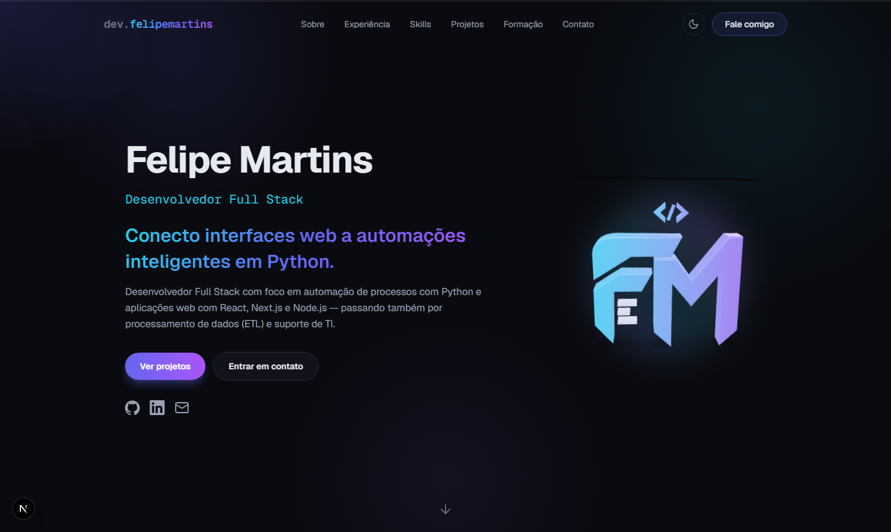

# Felipe Martins — Portfólio

Portfólio pessoal de **Felipe Martins**, Analista de Sistemas Júnior: automação de processos com Python e desenvolvimento full-stack com React e Next.js.

🔗 **Site no ar:** [devfelipemartins.com.br](https://devfelipemartins.com.br)



## Destaques

- Design dark tech, com tema claro/escuro
- Logo 3D interativa (gira sozinha e pode ser arrastada)
- Animações no scroll (GSAP) e rolagem suave (Lenis)
- Seções: Sobre, Skills, Experiência, Formação, Projetos e Contato
- Todo o conteúdo editável em um único arquivo (`src/data/portfolio.ts`)
- Deploy automático na Vercel a cada push na `main`

## Tecnologias

Next.js 16 (App Router, Turbopack) · React 19 · TypeScript · Tailwind CSS v4 · GSAP · Lenis · @google/model-viewer

## Como rodar

Requer **Node.js 20.9 ou superior**.

```bash
git clone https://github.com/devfelipemartins/portfolio.git
cd portfolio
npm install
npm run dev      # abre em http://localhost:3000
```

Outros comandos:

```bash
npm run build    # gera a versão de produção
npm start        # roda a versão de produção (depois do build)
npm run lint     # verifica o código com o ESLint
```

## Estrutura

```
src/data/portfolio.ts   → TODO o conteúdo do site (textos, links, projetos)
src/components/         → seções da página e efeitos de animação
src/app/                → layout, estilos globais e SEO
public/                 → imagens, prints dos projetos e o logo 3D
```

## Editando o conteúdo e publicando

Veja o [GUIA.md](GUIA.md): explica, passo a passo e sem precisar conhecer o código, como alterar os textos, trocar imagens, rodar no seu computador e publicar.
